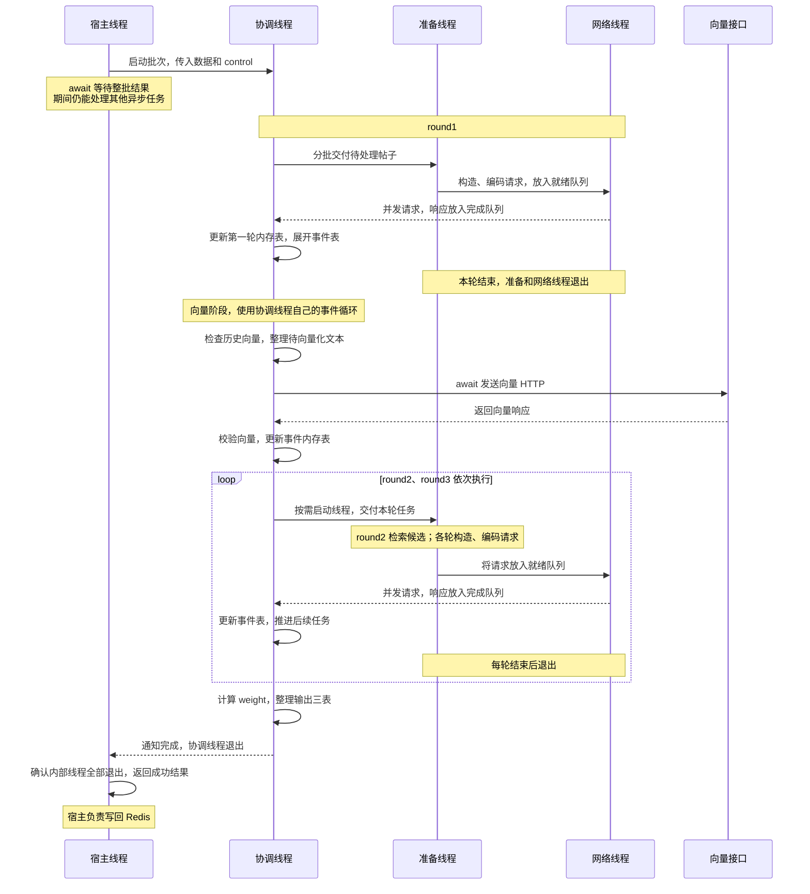

# 异步实盘函数（0.4.3）

公共入口是 async def run_live_batch；须 await 调用，不兼容旧同步入口和检查点续跑。接入方可直接使用 [精简接入说明](LIVE_HOST_HANDOFF.md) 与 examples/live_host_call.py。

```python
from crypto_x_ai_live import load_live_config, run_live_batch

config = load_live_config("/path/to/configs", max_attempts=100)
# 在 async 函数内：
result = await run_live_batch(posts_df, history_df, assets=assets, config=config,
                              aggregation_method="max_abs", timeout_seconds=840)
if result["status"] == "success":
    round1_results = result["round1_results"]
    event_results = result["event_results"]
    weight = result["weight"]
```

## 输入输出

new_posts 为新帖与积压原帖的去重合并 DataFrame，单层 date 索引是爬虫时间，可重复，支持有效时间字符串；普通列至少为字符串 id、text、user_name 和 UTC 发布时间 created_at，id 本批唯一。没有新帖可传空 DataFrame。包不修改输入。

history_results 是过去 100 天的第二、三轮共用事件表，索引为 (date,record_id)，date 是 UTC 发布时间。14 个基础列加已有 round2_call_meta、round3_call_meta；旧 14 列也兼容。历史目标资产须完成二、三轮。历史向量缺失、损坏、版本或维度不匹配时失败，不自动修复。

0.4.3 起，第一轮结束后只把事件 date 严格晚于内存历史表全表最大 date 的任务加入第二轮；截止时间是 UTC 原帖发布时间，所有资产共用，保留完整时分秒及精度。较早或同刻事件跳过并记录数量，空历史首次导入不受限制，同一批符合条件的事件一起处理。跳过事件不进入向量、第二轮、第三轮或事件增量；第一轮表仍返回本批全部已保存回答。已有索引的固定输入冲突仍会失败，历史数据保持原样。

assets 是宿主读取 xdata 中原 round2_asset_list_path 对应 JSON 后取出的 InstrumentList 字符串数组，支持币名或完整交易资产名，同币名不能重复。币名输出沿用 .USDT.UFUTURE.BINANCE 后缀。包不读取资产路径。

成功返回普通 dict：status=success，加上三张 DataFrame；第一轮表 10 列、事件增量 16 列。宿主只在成功时提交三张表。事件增量按索引更新，不代替完整历史。失败仅返回 {"status":"failed"}；总时限耗尽仅返回 {"status":"timeout"}，均无表或中间数据。错误原因、阶段及重试写标准 logging 日志，包不初始化宿主日志。

不再提供 LiveBatchError、LiveBatchResults、resume_state、round1_state 或 as_of。失败保留原帖，下次与新帖合并重算，不继承失败轮的回答、统计或时间窗口。

## 处理及并发

顺序仍是 round1 → 向量 → round2 → round3 → weight。复用旧输入构造、输出校验、配置摘要、HTTP 响应解析与重试决策、StoredVectors/EmbeddingRetriever、EventHistory、Store 字段写入和评分函数。旧独立脚本继续使用原执行器，事件导入同样受表尾时间限制。

### 线程分工与流程图

各阶段按顺序执行，线程分工发生在每一轮内部，让准备数据、发送请求、提交结果能够交错推进。AI 阶段通常有四个线程；向量和 weight 阶段不需要全部线程同时存在。准备、网络线程按轮次创建和关闭，并非同一组线程贯穿整批。



| 线程 | 主要职责 | 事件循环 |
| --- | --- | --- |
| 宿主线程 | 等待整批结果、监控超时。 | 宿主事件循环。 |
| 协调线程 | 运行整个处理流程，独占内存表，执行向量异步请求，分配任务、接收结果、推进下一阶段。 | 独立协调事件循环；三轮 AI 阶段调用原同步执行器，向量阶段直接 await。 |
| 准备线程 | 构造并编码 AI 请求，round2 的候选检索和相似度计算也在这里。 | 无。 |
| 网络线程 | 并发发送本轮 AI 请求，处理重试和连接关闭。 | 独立网络事件循环。 |

例如准备线程正在构造第 20 条请求时，网络线程可以等待前面多条请求的响应，协调线程同时提交已经完成的结果。各阶段之间顺序执行，阶段内部形成流水线。准备速度跟不上时，网络并发仍可能打不满；分工用于避免这些工作都占用同一个事件循环，并不保证始终达到配置的并发上限。

队列是进程内传递任务和结果的线程安全内存容器：准备线程将编码完成的请求放入有界 ready_requests 队列，网络线程将完成消息放入 completions 队列，协调线程消费完成消息并更新内存表。网络线程使用非阻塞取数和异步唤醒；同步队列等待在后台协调线程执行。

thread.join() 表示调用者等待指定线程结束，不会主动终止线程。内部需要等待的 join 在协调线程执行；宿主通过 await 等待完成通知，再异步检查协调线程是否退出，不在宿主事件循环中同步等待线程。

### 执行器复用与事件循环

实盘直接复用原 run_extraction、run_relation、run_impact，未维护第二套轮次调度。宿主 await 等待同进程协调线程的完成信号；协调线程独占内存表、执行原批次推进和结果提交；原准备线程独立检索候选、构造并编码请求；原网络线程的独立事件循环持续从有界就绪队列发送 HTTP，完成消息允许积压，结果提交不会占用网络发送名额。

就绪队列仍存已经编码、可直接发送的请求，而非尚需做检索的业务任务。concurrency 仅限制实际 HTTP 名额，ready_request_buffer_size 控制就绪队列。相似度计算在准备线程，Pandas 更新在协调线程，不在宿主或网络事件循环里做同步阻塞工作。沿用原 HTTP 平均/峰值并发与准备/保存耗时日志。

向量编码器直接改为原生异步：prepare 和 _request 为协程，使用 AsyncClient、await post 和异步退避，不保留同步兼容接口，也没有客户端桥接类。整个流水线协程在协调线程自己的事件循环运行；向量 HTTP 与保存回调都在该线程，宿主循环只等待整批完成，三轮 AI 的网络线程继续独立运行。统一停止信号会取消向量请求、初始化或退避，随后等待客户端关闭。实盘内存写入只尝试一次，避免进入旧存储重试等待。独立向量 CLI 在顶层使用 asyncio.run 调用 prepare_vectors 协程。
同资产按发布时间推进，同一时刻事件共享此前历史，整波保存后才登记历史、处理下一时刻；不同资产可并行。第三轮先完成 new/update 的 AI，再按时间为 repeat 继承严格更早且三个月内的有效响应，同刻不能互相继承。

config.run.concurrency 控制本阶段最大 HTTP 并发；max_attempts 是次数上限，实际请求还受全批时限约束。client_factory(config) 是测试/自定义 HTTP 注入入口，每次应返回新的 AsyncClient，不跨事件循环复用同一个客户端；生产通常省略。

宿主和协调线程各自有一个事件循环；三轮 AI 工作期间还会创建原网络事件循环。协调线程调用同步轮次执行器时，停止由原执行器的线程信号处理；向量阶段直接 await 异步请求。跨线程通知使用 call_soon_threadsafe；客户端、Task 和异步锁等对象由所属循环管理，不跨循环复用。跨线程调度规则见 [Python 官方说明](https://docs.python.org/zh-cn/3.8/library/asyncio-dev.html#concurrency-and-multithreading)。

## 取消与时限

整批输入、各轮、向量和 weight 共用 time.monotonic() 的截止时间，默认计算预算 840 秒。原执行器新增可选 control 参数：在协调循环、准备环节及内存读写边界检查停止；没有 control 的旧独立脚本保持原流程。

例如预算为 840 秒，round1 和向量合计用了 150 秒，后续阶段约剩 690 秒；进入下一轮或重试不会重新获得 840 秒。

超时或宿主取消后的顺序是：

1. control 设置共享停止标志，通知准备和网络线程。
2. 准备线程被唤醒并停止补货；网络事件循环停止发送新请求，取消在途请求和退避，等待请求协程清理完成并关闭客户端。
3. 协调线程在检查点停止，等待准备和网络线程退出，丢弃失败轮的中间结果，不生成检查点。
4. 宿主异步等待协调线程真正退出，再返回 timeout，或向宿主传播 CancelledError；重复取消也先等清理完成。

使用内置 timeout_seconds 返回 timeout 状态；宿主主动 task.cancel() 在上述收尾完成后传播 CancelledError。普通业务失败返回 failed。程序退出类异常不吞掉。新一轮必须等上一调用及全部执行线程结束，不能重叠启动。

线程与异步超时可以配合，但通知停止不等于已经退出。例如同步相似度计算正在执行时，停止信号可以先发出，需要等计算返回、检查到信号后才退出。宿主事件循环本身也必须保持可运行，才能及时处理超时。

同步长计算或底层库阻塞无法被 Python 安全强杀；宿主仍需为等待它们退出、连接关闭和 Redis 写回预留时间。计算预算不等于异常情况下的硬终止保证。和只对后台线程套 wait_for 不同，本入口会实际通知内部执行器停止并等待回收，不能在超时后放任旧线程继续运行。

### 为什么保留线程分工

| 方案 | 特点 |
| --- | --- |
| 单线程同步执行 | 实现直接，但等待 HTTP 时难以推进其他工作，也无法在同步阻塞期间及时处理取消。 |
| 单线程运行异步任务 | 可以并发多个 HTTP 请求，但同步计算会同时拖慢网络调度和超时处理。 |
| 当前线程分工 | 结构多一些，但能复用旧执行器，将同步准备、表更新与网络事件循环分开。 |

单线程异步可以通过多个协程并发请求，关键是在等待时使用 await，让事件循环处理其他任务。但相似度计算、请求构造和 Pandas 操作属于同步工作：如果在唯一的事件循环里连续运行 3 秒，这 3 秒内完成回调、补发请求和超时回调都会被推迟。相关原理见 [Python 对阻塞代码的说明](https://docs.python.org/zh-cn/3.8/library/asyncio-dev.html#running-blocking-code)。

从零设计时，单线程异步可以是较简单的起点；以本项目尽量复用旧代码、保留原并发分工为前提，当前方案改动更集中。改成全流程单线程，需要进一步拆分同步计算并安排让出执行权，单纯减少线程数并不能解决超时问题。多线程也不保证 CPU 计算按线程数成倍加速，这里的主要用途是分离计算、网络等待和结果提交。

## 时间与 weight

输入爬虫 date 仅校验；从 created_at 规范为无时区的 UTC 发布时间索引，供三轮与旧 B 兼容。无时区 created_at 按 UTC 理解，带时区先转 UTC，支持原始 X 日期文本。处理表输出 date 保持 UTC，不提前加 8 小时。

调用开始自动取得 UTC 系统时间，作为 100 天历史范围和本轮窗口基准；最终表复制完成后再自动取 UTC+8 系统时间填 weight.date。若 16:47 开始、稍后完成，聚合仍按 16:47 的窗口；下一轮从头调用会使用下一轮窗口。

cutoff = 本轮 UTC+8 开始时间向下取最近 15 分钟刻度，筛选：

```text
cutoff.floor("h") - 15min <= 原帖UTC发布时间 + 8h < cutoff
16:02 → [15:45,16:00)
16:17 → [15:45,16:15)
16:32 → [15:45,16:30)
16:47 → [15:45,16:45)
17:02 → [16:45,17:00)
```

按更新后 B+A 的成功事件计算 max_abs 或 sum；max_abs 保留符号，同绝对值取最早发布时间。输出一行 float64 宽表，date 是最终输出时间，列顺序与 assets 一致，无信号为零。不写旧整点聚合表。

## 调用统计

round1_call_meta、round2_call_meta、round3_call_meta 为 JSON 字符串，保留 started_at、finished_at、attempts、retry_count、attempts_total、retry_count_total、retry_reasons。沿用旧 CallRecorder 与 Store 规则；规则判新、继承本轮次数为零，继承另记 source_record_id。原 response 的 attempts 保持响应本身的次数。

失败轮不返回表，下次重算统计重新开始；成功轮的实际自动重试记录保存进输出。宿主不能按旧 9/14 列截断保存。

## 安装与验证

python -m pip install crypto_x_ai_live-0.4.3-py3-none-any.whl。依赖由 pyproject.toml 声明，配置可由 load_live_config 指定外部目录。发行包使用私有 _engine 隔离旧通用模块名；没有 Redis/xdata 客户端、密钥、原帖或模型权重。

旧审计及其价格口径保持原样；本修改不涉及收益贡献审计。
